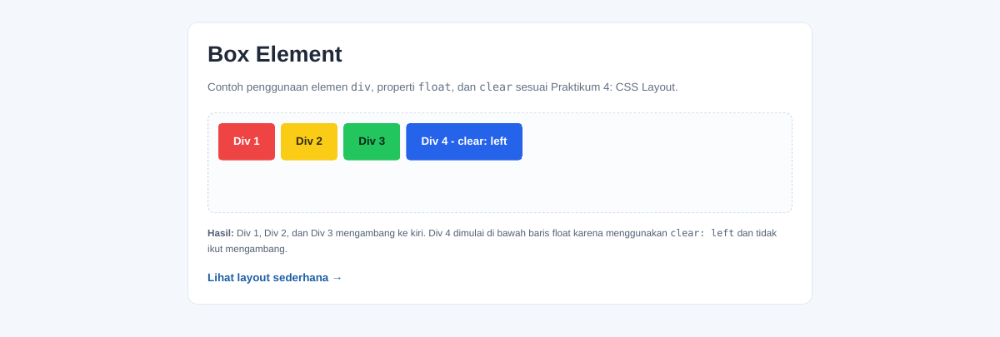
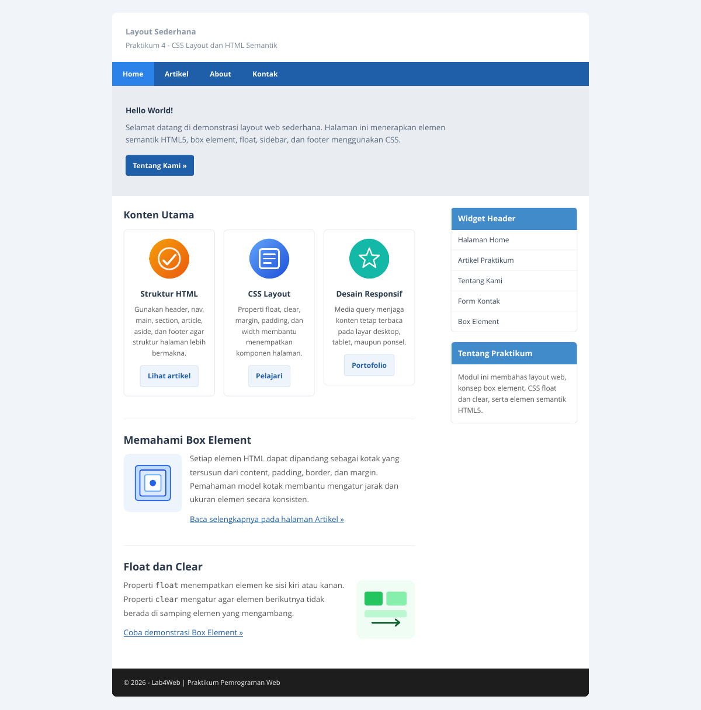
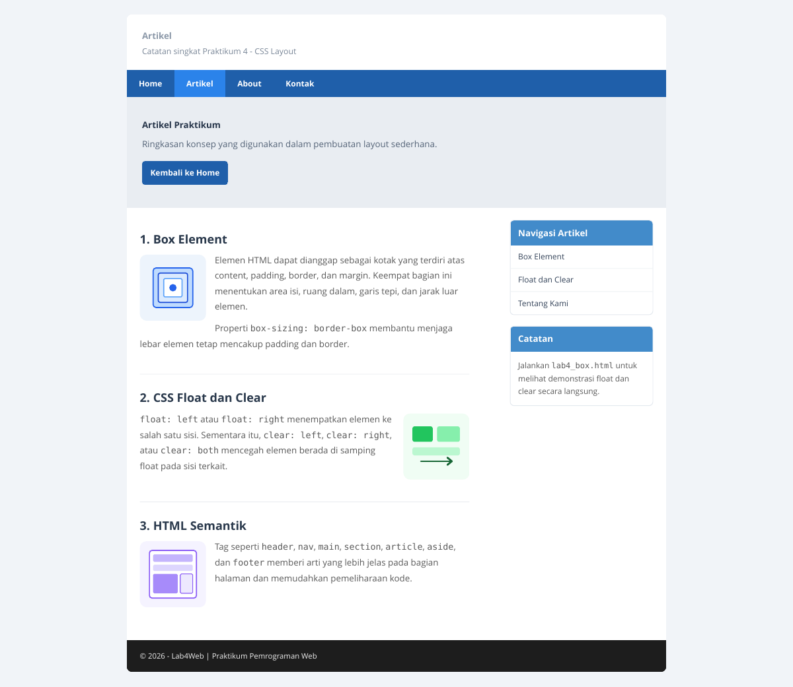
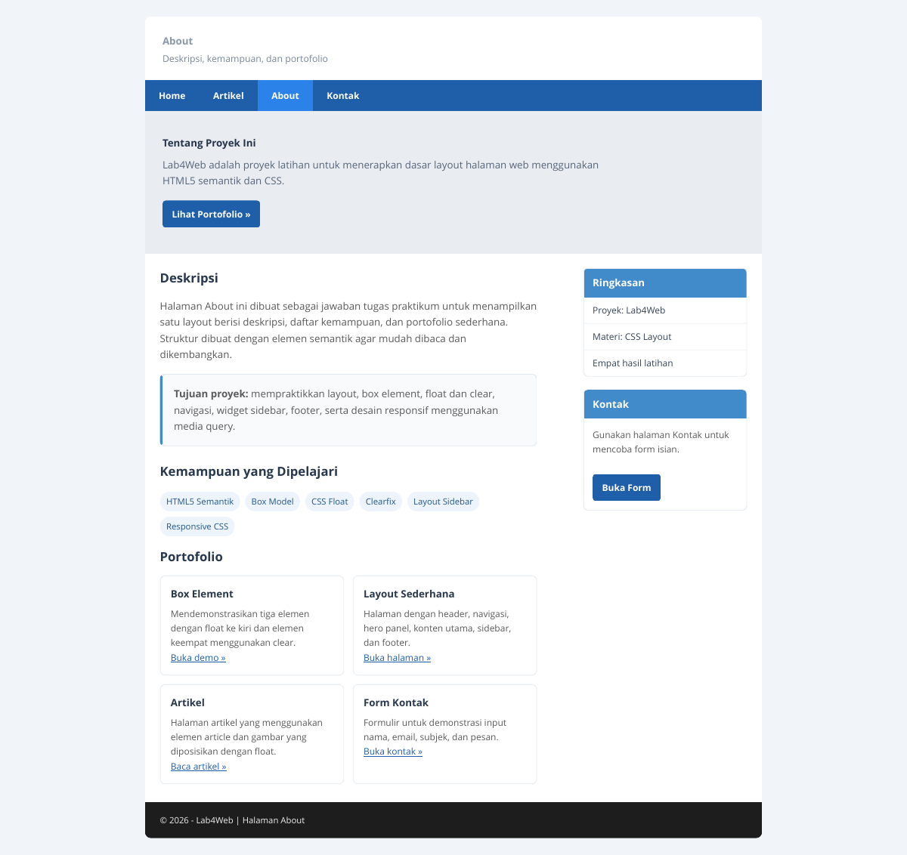
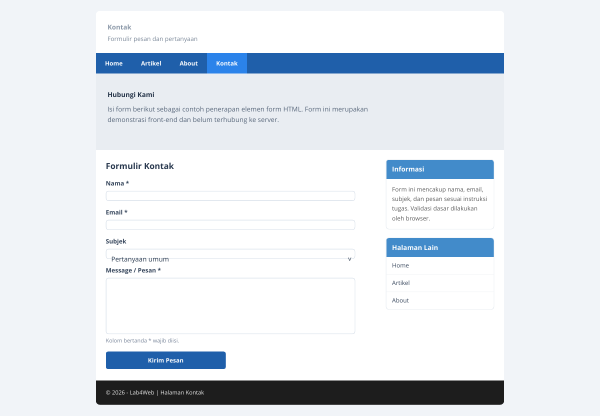

# Lab4Web - Praktikum 4: CSS Layout

Repositori ini berisi hasil Praktikum 4 Pemrograman Web berdasarkan modul **CSS Layout**. Proyek mempraktikkan box element, CSS `float` dan `clear`, layout sederhana dengan HTML semantik, sidebar widget, artikel, halaman About, dan formulir Kontak.

Laporan ringkas: [Laporan Praktikum 4 - CSS Layout](Laporan_Praktikum_4_CSS_Layout.pdf).

## Struktur Folder

```text
Lab4Web/
├── lab4_box.html
├── lab4_layout/
│   ├── home.html
│   ├── artikel.html
│   ├── about.html
│   ├── kontak.html
│   ├── style.css
│   └── assets/
│       ├── feature-orange.svg
│       ├── feature-blue.svg
│       ├── feature-teal.svg
│       ├── article-box.svg
│       ├── article-float.svg
│       └── article-semantic.svg
├── screenshots/
└── README.md
```

## Praktikum

### 1. Membuat `lab4_box.html`

File ini memperlihatkan tiga kotak yang menggunakan `float: left` dan kotak keempat yang menggunakan `clear: left` serta tidak ikut mengambang. Perubahan ini menunjukkan bagaimana elemen selanjutnya dapat dipindahkan ke baris baru setelah elemen float.



### 2. Membuat layout utama

Folder `lab4_layout` berisi `home.html` dan `style.css`. Layout menggunakan header, navigasi, hero panel, konten utama, sidebar, dan footer. CSS menerapkan box model, float, clearfix, widget, kartu konten, gambar artikel, serta media query untuk layar yang lebih kecil.



### 3. Menambahkan halaman Artikel

File `artikel.html` berisi ringkasan box element, float dan clear, serta elemen semantik HTML5. Gambar pada artikel diposisikan dengan CSS float.



### 4. Menyelesaikan tugas About

File `about.html` berisi deskripsi proyek, tujuan, kemampuan yang dipelajari, dan portofolio sederhana yang menghubungkan ke halaman latihan lain.



### 5. Menyelesaikan tugas Kontak

File `kontak.html` berisi form nama, email, subjek, dan pesan. Browser melakukan validasi dasar pada input wajib dan format email. Form ini hanya demonstrasi front-end; belum mengirim data ke server atau database.



## Cara Menjalankan

1. Unduh atau clone repositori ini.
2. Buka file `lab4_box.html` di browser untuk melihat demonstrasi box dan float.
3. Buka `lab4_layout/home.html` untuk melihat website utama.
4. Gunakan navigasi Home, Artikel, About, dan Kontak untuk berpindah halaman.

Tidak diperlukan instalasi framework atau dependensi JavaScript.

## Ringkasan Hasil

- Memahami penggunaan elemen box dan konsep box model.
- Menerapkan `float` dan `clear` untuk mengatur posisi elemen.
- Membuat layout memakai elemen semantik HTML5.
- Mengimplementasikan sidebar, widget, footer, dan artikel.
- Membuat halaman About serta form Kontak sesuai tugas modul.
- Menambahkan CSS responsif agar layout beradaptasi pada layar kecil.


